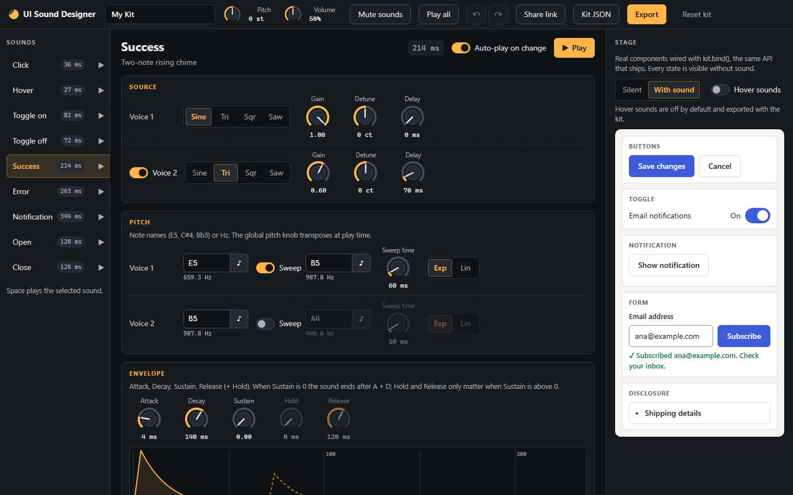
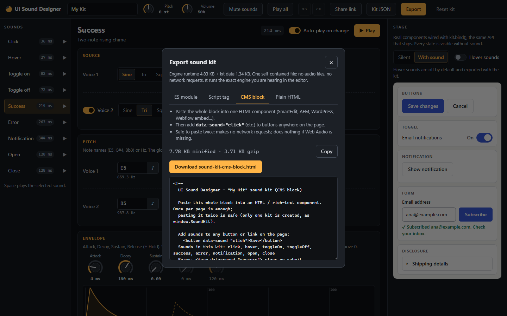
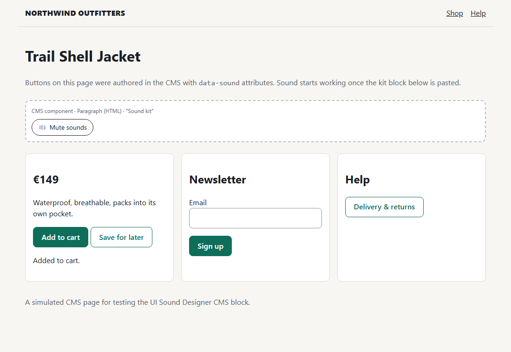

# UI Sound Designer

Design interface sounds by ear, preview them on real UI components, and export a tiny,
self-contained JavaScript sound kit, with **zero audio files**. Every sound is synthesized live
with the Web Audio API.



Sound is treated like a design token. One kit shares a single character (pitch range, timbre,
tail length) across every interaction, maps to semantic names (`click`, `success`, `error`…),
and can be re-themed the way a color palette can. Designers tune by ear; developers get one
small file.

**One engine.** The editor and the exported kit run the exact same synth engine
(`src/engine`). What you hear while designing is what ships, and a test renders every preset
through both and requires the samples to match.

---

## Quick start

```bash
npm install
npm run dev          # editor at http://localhost:5173
```

| Script                | What it does                                                  |
| --------------------- | ------------------------------------------------------------- |
| `npm run dev`         | Editor with hot reload (builds the engine runtime first)      |
| `npm run build`       | Static site in `dist/`, deployable anywhere (relative URLs)   |
| `npm test`            | Unit tests (Vitest)                                           |
| `npm run test:e2e`    | Browser tests (Playwright: Chromium, WebKit, mobile profiles) |
| `npm run size`        | Size budget check with a per-module breakdown                 |
| `npm run typecheck`   | `tsc --noEmit` (strict)                                       |
| `npm run lint`        | ESLint + Prettier check                                       |
| `npm run screenshots` | Regenerates the README images (needs `npm run dev` running)   |

First e2e run: `npx playwright install chromium webkit`.

---

## Using the editor

- **Sounds (left).** The 8 sound types (open / close count as one), each with a play button and
  its length. The badge turns red above 500 ms: UI sounds should be short. Click a row to edit
  it. **Space** plays the selected sound.
- **Synth panel (center).**
  - **Source:** wave per voice, voice 2 on/off, gain, detune, delay.
  - **Pitch:** start note, sweep target, sweep time and curve. Notes are typed as names
    (`E5`, `C#4`, `Bb3`) or Hz, or picked on a small keyboard.
  - **Envelope:** A / D / S / R (+ hold) with a live drawing. With **Sustain 0** the sound ends
    after attack + decay; hold and release only matter when sustain is above 0.
  - **Filter:** low-pass or band-pass, cutoff, resonance.
  - **Texture:** noise blend.
  - **Output:** recipe gain, peak meter (dBFS), waveform and a live scope.
- **Every change auto-plays** the sound (debounced, can be switched off). Knob drags undo as
  one step.
- **Knobs:** drag vertically (**Shift** = fine), use the mouse wheel, double-click to reset,
  click the value (or press **Enter**) to type an exact number such as `5.2k` or `140`. From the
  keyboard: arrows step, **PageUp/PageDown** take big steps, **Home/End** jump to min/max.
- **Top bar:** kit name, **global pitch** (±12 semitones) and **volume**, mute, Play all,
  undo/redo (**Ctrl/Cmd+Z**, **Ctrl/Cmd+Shift+Z**), **Share link**, **Kit JSON**, **Export**,
  Reset kit.
- **Stage (right):** real components wired through `kit.bind()`, the same API that ships.
  It has buttons, a switch, a toast, a validated form, a disclosure, a hover sounds switch
  (off by default) and a **Silent / With sound** A/B switch. Every state is visible without
  sound.
- **Saving:** the kit autosaves in your browser. Share links carry the whole kit in the URL
  (`#k=…`, compressed); opening one asks before replacing your work. **Kit JSON** copies,
  downloads, pastes or opens kit files, validated on the way in.

---

## Exporting



| Tab            | File                       | Use it when                                               |
| -------------- | -------------------------- | --------------------------------------------------------- |
| **ES module**  | `sound-kit.js`             | You have a bundler or `<script type="module">`            |
| **Script tag** | `sound-kit.iife.js`        | Classic `<script>`; exposes `window.SoundKit`, auto-binds |
| **CMS block**  | `sound-kit-cms-block.html` | You can only paste HTML into a CMS component              |
| **Plain HTML** | `sound-kit-example.html`   | You want a complete example page                          |

Each export is the minified engine plus your kit JSON (defaults stripped) in one file. The
modal shows its minified and gzip size. No audio files, no network requests.

### Using the CMS block (SmartEdit and similar)

1. In the editor, open **Export → CMS block → Copy**.
2. In your CMS, add an **HTML / rich text / paragraph component** to the page (or to a shared
   header or footer slot) and paste the whole block. It contains usage notes, a styled **Mute
   sounds** button and one inline script.
3. Add `data-sound="…"` to buttons and links anywhere on the page:

   ```html
   <button data-sound="click">Save</button>
   <form data-sound="success">…</form>
   <!-- plays on submit -->
   ```

4. Publish. The block:
   - makes **zero network requests**;
   - is **idempotent**: pasting it twice still creates a single kit (`window.SoundKit`), and
     every `[data-sound-mute]` button works;
   - leaks **no globals** other than `window.SoundKit`;
   - **does nothing** (silently) where Web Audio is unavailable.

Try it locally: paste the block over `<!-- PASTE CMS BLOCK HERE -->` in
[`examples/cms-block.html`](examples/cms-block.html) and open the file in a browser. For the
script-tag export use [`examples/plain.html`](examples/plain.html).



---

## The kit API

The same API in the editor and in every export.

```js
import kit from './sound-kit.js'; // default export: a ready-made kit instance
// or: window.SoundKit (script tag / CMS block)

kit.bind(); // auto-wire [data-sound] elements; returns an unbind function
kit.play('success'); // play by semantic name
kit.play('click', { pitch: 3 }); // per-play transpose in semitones (e.g. a slider tick)
kit.volume(0.4); // master volume 0..1 (defaults to the kit's theme volume)
kit.mute(true); // persisted per visitor (localStorage "soundkit:muted")
kit.isMuted();
kit.mountMuteToggle(buttonEl); // any button becomes an accessible mute toggle (aria-pressed)
kit.update(newKitJson); // hot-swap recipes
kit.render('success', offlineCtx); // schedule on any BaseAudioContext; returns its length in seconds
kit.destroy();
```

`createKit(kitJson, options)` is also exported, for extra kits. Options: `hover`, `voiceCap`,
`respectReducedMotion`, plus `seed` and `tap`, which are only for tests and the editor.

### How `bind()` reads `data-sound`

- **click** on an element (or inside it) with `data-sound` plays that sound. Forms are
  skipped on click.
- **submit** of a `<form data-sound="…">` plays the form's sound.
- **hover**: entering a `[data-sound]` element plays `hover`, but only when the kit's
  `options.hover` is on. It is rate-limited to one per 80 ms and never fires for touch.

The attribute is read **after your own handlers run**, so a component can set
`data-sound="toggleOn"` / `"toggleOff"` (or `"success"` / `"error"`) in its own handler for the
action that just happened. The stage and `examples/cms-block.html` both do this.

### Mute and quiet preferences

The kit starts muted, or never plays, when:

- the visitor muted before (stored per visitor; `kit.mute(false)` undoes it);
- the site sets `<html data-sound="off">` or `window.SOUNDKIT_OFF = true` (hard off);
- `prefers-reduced-motion: reduce` matches. There is no "reduced sound" media query, so this is
  treated as an opt-out signal by default (`respectReducedMotion: false` turns it off). A
  visitor's explicit choice wins on later visits.

Audio starts only after the first user gesture (pointerdown / touchend / keydown). Sounds
requested before that are dropped, never queued. On iOS the kit plays a one-sample silent
buffer to unlock audio and resumes after interruptions.

### Recipes

Every sound is a small JSON recipe ([`src/engine/types.ts`](src/engine/types.ts)):

```json
{
  "voices": [
    { "wave": "sine", "note": "E5", "sweepTo": "B5", "sweepMs": 60 },
    { "wave": "triangle", "note": "B5", "delayMs": 70, "gain": 0.6 }
  ],
  "env": { "a": 4, "d": 140, "s": 0, "r": 120 },
  "filter": { "type": "lowpass", "cutoff": 5200, "q": 0.7 },
  "noise": 0,
  "gain": 0.35
}
```

A kit is `{ v, name, theme: { pitch, volume }, sounds: { name: recipe }, options: { hover, voiceCap } }`.
Theme transforms apply at play time and never change recipes. Unknown future fields (`fx`, new
wave types, theme keys) are kept on load and save; unknown waves are skipped during playback.

---

## Keeping a kit coherent

- **One family.** Share timbre (mostly sine and triangle), a pitch neighborhood (around E5–B5),
  soft low-pass filtering and short tails across every sound. If one sound needs a different
  character, question it first.
- **Direction carries mood.** Rising pitch for positive and opening actions (success, toggle
  on, open); falling for negative and closing ones (error, toggle off, close). Mirror pairs
  should actually mirror each other.
- **A loudness hierarchy.** Hover is barely there, clicks are quiet, and notifications and
  outcomes are a little more present. Keep peaks well below clipping: watch the peak meter
  (around −12 dBFS or lower is comfortable).
- **Short.** Most sounds finish well under 250 ms; the editor flags anything over 500 ms.
- **Re-theme globally.** To make the whole kit brighter, lower or quieter, use the global
  pitch and volume knobs instead of editing sounds one by one.
- **Errors stay soft.** Lower pitch and a gentle dissonance read as "not quite", without
  alarm.
- **Sound never carries meaning on its own.** Every state must be visible without sound:
  A/B the stage with **Silent / With sound**. Ship the mute button. Leave hover off unless you
  have a reason.

---

## Architecture

```
Knobs & presets ─► JSON recipes ─► Exporter ─► sound-kit.js ─► live website
       │                                ▲                        │
     plays                         bundled in                    │
       ▼                                │                        ▼
Component stage ◄──── shared synth engine (src/engine) ─────────►  plays
```

- `src/engine/`: the engine. Framework-free, zero dependencies, imports nothing outside
  itself (enforced by ESLint).
  - Each play builds fresh oscillator, filter and gain nodes and disconnects them when they end.
  - One AudioContext, created inside the first gesture.
  - A voice cap of 8 steals the oldest voice with a ~5 ms fade.
  - Retriggers are limited per sound and hover is rate-limited.
- `scripts/build-runtime.mjs`: esbuild turns `src/engine` into two minified strings (ESM and
  IIFE) in `generated/`. The editor imports them with Vite `?raw`; the exporter only
  concatenates strings and never bundles at runtime.
- `src/editor/`: plain TypeScript and small custom elements (`<sd-knob>`, `<sd-segmented>`,
  `<sd-note>`), with one store for undo/redo and autosave. The editor plays sound **only**
  through `src/engine/index.ts` (enforced by ESLint).
- `src/export/`: assembles the four export formats.

### Size budget

Enforced by `npm run size` and a unit test (1 KB = 1024 B):

| Part                                    | Budget         | Now               |
| --------------------------------------- | -------------- | ----------------- |
| Engine runtime (minified / gzip)        | 5 KB / 2.75 KB | 4.83 KB / 2.52 KB |
| Engine + 8-sound default kit (minified) | 7 KB           | 6.24 – 6.54 KB    |

The original targets were 4 / 2 / 6 KB. They were raised with agreement after measuring the
full v1 engine. When a budget fails, `npm run size` shows which module grew against
`scripts/size-baseline.json`.

---

## Testing

- **Unit (Vitest):** note parsing, the validator, theme math, the limiter (fake clock),
  envelope scheduling, the store, URL share round trips, exporter output and contrast.
  - The exporter tests check that the output contains the kit JSON, makes no network calls,
    references no audio files and parses as valid JS.
  - A same-source test checks that `generated/` is a fresh build of `src/engine`.
- **Browser (Playwright):**
  - Every preset renders offline: not silent, peak < 0.9, tail decays, under 500 ms.
  - **Same engine:** each preset renders sample-identical from the editor's engine and from an
    exported `sound-kit.js` loaded from a blob URL.
  - Gesture unlock, including the touch path.
  - Mute persistence and quiet preferences.
  - The stage is usable muted and keyboard-only.
  - Example pages work with zero network requests and no console errors.
  - Accessibility checks: control names, keyboard workflow, focus.
  - Mobile profiles.

**WebKit on Windows:** Playwright's WebKit build for Windows ships **without the Web Audio API**,
so on Windows the WebKit tests that need audio output are skipped, with that reason. Everything
else runs in WebKit, including the no-Web-Audio fallbacks. Run the suite on macOS or Linux for
full Safari audio coverage, and check on a real iPhone before shipping.

**CI** ([`.github/workflows/ci.yml`](.github/workflows/ci.yml)) runs on Linux, where WebKit has
Web Audio, and has two jobs:

- **Checks:** typecheck, lint, unit tests, size budget and build.
- **Browser tests:** all Playwright projects, with a PulseAudio null sink as the audio
  output. The job then runs `scripts/check-e2e-skips.mjs` on the JSON report, which **fails**
  if any test was skipped for missing Web Audio, so WebKit audio coverage cannot quietly
  disappear. On failure, the test artifacts are uploaded.

---

## Project structure

```
src/engine/      shared engine (createKit, types, notes, context, voice, envelope, noise,
                 limiter, theme, prefs, bind, render) + schema.ts (validator, editor-only)
src/presets/     default-kit.ts: the starter recipes
src/editor/      main.ts, store.ts, share.ts, ui/ (knob, segmented, note field, lists),
                 panels/ (synth, envelope view, scope, stage, export modal), styles/
src/export/      build-kit.ts, snippets.ts, runtime.ts (?raw imports)
scripts/         build-runtime.mjs, check-size.mjs, screenshots.mjs
generated/       runtime build output (gitignored)
examples/        plain.html, cms-block.html (paste targets)
tests/unit, tests/e2e, tests/pages (test harness pages, dev server only)
```

## Not in v1 (the data model leaves room)

These are planned but not built:

- The full 16 sound types.
- FM / bell voices, bit-crush, humanize and room reverb (the `fx` field is preserved now).
- Kit themes for brightness, length and material.
- A coherence check, and randomizing within a theme.
- WAV / ZIP export (`kit.render()` already works on an `OfflineAudioContext`).
- An npm package and a React hook.
- Upload-your-own-HTML on the stage.
- Libraries, accounts and team sharing.
